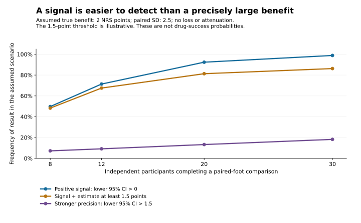

# Topical erlotinib: development and investment dossier

> **Priority update:** The [reconciled current shortlist](../../../decisions/current-shortlist.md) governs new work. This record retains its dated evidence, scope, estimates and conclusions; its internal priorities are historical.

**Decision date: 9 November 2026 UTC / 8 November Los Angeles. Candidate R26-LOC-01.** Public-source diligence for a reproducible topical erlotinib product with defined background care in painful KRT16 p.Arg127Cys palmoplantar keratoderma. The user requested substantial research and clarified that **$500,000 is a reference budget, not a strict cap**.

## Current use of this dossier

The subsequent [commercial-route comparison](../../commercial-routes/README.md) revised the pilot-as-default framing; the [reconciled current shortlist](../../../decisions/current-shortlist.md) governs new work. **Retain erlotinib as a serious scientific lead; first compare existing-product access and a specific contribution that could be licensed before we finance a human trial.** The clinical design below is a conditional development option, not the default next commitment. The evidence does not establish a high probability of Phase II success or cash recovery.

The preserved pilot scenarios are $462k with a usable existing package or $624k independently for 15 randomized participants, and $510k/$672k for 19. They are analyst allowances, not named-provider quotes, a geographic cost model or validated operational feasibility. The [assumption audit](../../commercial-routes/assumptions-and-method.md) explains their provenance and the limits of earlier conversational failure/exit estimates. A $750k scenario does not authorize spending or establish a sufficient reserve.

A self-funded new venture starts with 100% founder equity. Asset-license payments, collaborators and later dilution require separate terms. The historical participation sensitivities in the economic record are not expected founder ownership. Preserve the [35-candidate baseline](../ranking-review/README.md), including APR's evidence, without treating its old capital filter or the recency of this dossier as an allocation rule.

## What carries the case, and what weakens it

| Finding | Weight in the decision |
|---|---|
| Two adults with the exact KRT16 variant received topical treatment, including randomized blinded opposite-foot phases | More direct than a preclinical-only hypothesis. They were mother and son: **one pedigree**, unequal response, incomplete paired pain data. |
| The mother improved substantially with the higher-strength ointment plus keratolytic care | Clinically encouraging, but the reported active-foot pain range is not an active-minus-vehicle effect estimate. Later walking/swimming improvement occurred in an uncontrolled extension. |
| Other topical experiences were mixed or inadequate | Two published patients on a different 0.2% cream lacked adequate sustained control; an industry PPK study reported modest improvement; a separate Darier study did not separate from vehicle. Different products/diseases prevent pooling, but these findings constrain a broad success narrative. |
| Disease tissue and oral experience support EGFR-linked biology | Useful rationale; they do not validate local delivery or imply that the exact variant predicts response. Shared family factors remain an alternative explanation. |
| A topical platform has human exposure experience | Potential product-development savings **only if the actual article, supporting records and rights are available**. It is not equivalent to the positive historical ointment. |
| EGFR also supports skin integrity and repair | The objective is useful pain relief with preserved skin integrity. Callus thinning or pathway inhibition alone is insufficient, especially if fissures or fragility worsen. |

The [human audit](human-evidence.md) reconstructs the original phases, timing discrepancies, ten study/report lineages and overlapping publications. The [biology/safety review](biology-safety.md) separates mechanistic support from local barrier risks. The most consequential limitations are largely older evidence and missing product information; this conclusion is not driven by a new paper's date or a vote among agents.

## Three product routes must stay separate

1. **Recover the successful historical article.** This is the closest replication, but its full vehicle, starting material, strength convention, batch records, applied mass and stability are not public. If those records cannot be recovered, call the replacement a new product with a bridge, not an exact reproduction.
2. **Use an existing sponsor product and dossier.** This may save CMC and safety work. Its different formulation/strength still needs its own relevant efficacy assessment. Do not combine Lee's efficacy, another cream's stability and SGT-210's exposure claim into an imaginary fully qualified product.
3. **Develop an independent controlled product.** This gives more operational control but requires additional qualification and potentially safety work. The extra central cost is not a reason to reject it automatically; compare the extra control and retained interest against that cost.

The [product dossier](product-cmc.md) defines the article-to-evidence bridge and cost modules. The public MUSE patent describes 12 healthy participants and concentrations below assay quantitation limits—**97.73 ng/mL parent and 9.783 ng/mL metabolite**—rather than zero systemic exposure. This does not quantify a safety margin for chronic use on fissured, keratolytic-treated plantar skin. A sensitive assessment under relevant conditions is a central development requirement.

The starting [target profile](target-profile.md) is adult local symptom control on standardized background care. R127C is a replication anchor, not a validated response biomarker. Other KRT16 variants or PC genes could enter separately justified exploratory cohorts; broader market claims require broader evidence.

## Conditional clinical design if a later decision justifies it

If a human pilot is later justified, the preferred initial concept is a blinded active-foot versus vehicle-foot comparison of local pain, on the same background care. It depends on credible masking, separate application, low cross-foot/systemic interference and a pain measure patients can attribute to each foot. Whole-person mobility needs a separately suitable design; improvement in walking during an extension cannot become a randomized foot-level functional result.

The [clinical design](clinical-design.md) contains estimands, outcome development, missing-data handling, family dependence and alternatives. A reproducible model explores **864 conditional scenarios**, with 100,000 replications per base simulation scenario and shared random draws for related comparisons. It does not fit the two reported cases or estimate erlotinib's success odds.



For example, assuming a true 2-point local benefit and paired SD 2.5, 12 independent completers detect a positive signal in **71.4%** of simulated studies. A signal plus an estimate of at least 1.5 points occurs in **67.5%**; a confidence interval entirely above 1.5 occurs in **9.1%**. Neither the SD nor the 1.5-point threshold was estimated from the cases or validated for this population. The last result uses a deliberately stringent, illustrative precision criterion, not a Phase II requirement. A positive pilot can be useful without meeting it. With 20 completers these frequencies are **92.4%, 81.3% and 13.2%**. Attrition, related participants and interference materially reduce information.

Under independently assumed 80% retention, 15 randomized participants give 12 expected completers but only a **64.8%** chance of at least 12. Nineteen gives **97.7%**. These calculations assume recruitment succeeds; they do not create eligible participants. Historical official registry tables report **60 R127C people/20 families in January 2018** and **88/33 in January 2021**. The published 13-person R127C analytic subgroup is a different denominator. None is a current reachable, sufficiently symptomatic adult cohort, and R127C can have milder disease. See the source-access limitations in the human and clinical records.

## Historical pilot-cost scenarios

| Planning scope | Existing usable product/dossier | Independent product qualification |
|---|---:|---:|
| Initial definition/access/feasibility gate, central cumulative spend | $60k | $78k |
| Qualified delivery/bridge gate before main clinical commitment, central cumulative spend | $174k | $300k |
| 15 randomized, central total through pilot closeout | $462k | $624k |
| 19 randomized sensitivity, central total | $510k | $672k |
| Reference $750k capacity less the 19-person total | $240k | $78k |
| Reference $1m capacity less the 19-person total | $490k | $328k |

Gate amounts are cumulative, not additive. They assume separately terminable work and include allocated contingency. They are proposed scenarios, not commitments or quotes. The 19-person sensitivity holds the base two-site setup constant; additional sites or delay cost more. The full low/base/high pilot ranges are **$230k/$462k/$1.025m** with transfer and **$304.75k/$624k/$1.375m** independently. These scenarios vary enrollment and execution difficulty; high is not a worst-case ceiling. Central elapsed assumptions are approximately **18 and 24 months**, respectively.

The additional capacity between $500k and $750k exceeds the preserved central pilot assumptions, but unquoted costs and unresolved access prevent concluding that the program is operationally feasible or the reserve sufficient. Any additional capital needs a named decision-changing use; available cash alone does not justify a later gate. Neither route includes a major newly required safety program, pivotal development, registration or launch. A deliberately illustrative follow-on package spans another **$0.81m–$4.75m**, central $2m; it is not a power-derived or regulatory-approved plan. Successful first evidence can still end at a financing stop.

The [economic dossier](market-economics.md) retains component allowances, staged-loss assumptions, revenue sensitivities and historical participation algebra. None establishes a sale price, a buyer or an expected ownership concession. Current comparison starts with full founder ownership and itemizes any actual asset-level burdens separately; no cash-recovery probability is calibrated.

## Rights and market determine whether good medicine becomes a good investment

The [claim-level rights review](ip-regulatory.md) found no reviewed issued US claim establishing a blanket adult-KRT16 monopoly. It did identify relevant pending debridement/regimen and composition claims, separate pediatric/support claims, and practical control of product and data. Official prosecution, title and territorial status remain incompletely verified; this is not freedom-to-operate clearance.

Sol-Gel, the French institutional/CTRS history, and Alembic's US orphan designation represent distinct interests. Orphan designation is not approval or current marketing exclusivity; another formulation cannot simply assume it escapes the same-active-moiety framework. A plausible US route is an IND and, if successful, a scientifically justified 505(b)(2) application, with the actual local-product bridge—not an automatic shortcut from generic oral tablets.

The exact-variant commercial population is unresolved. Historical carrier counts cannot be converted directly to paying chronic users. Broader indication potential is an upside hypothesis that needs separate clinical support. Topical TRPV3 development, planned oral programs, procedural care and the failed VAPAUS topical-rapamycin study all inform differentiation, recruitment and endpoints. No head-to-head evidence establishes erlotinib's superiority.

## Conditional development gates

| Decision | Evidence that warrants it |
|---|---|
| Advance the product-specific package | Reproducible article and interpretable local/systemic exposure; credible independent recruitment and outcome assessment; usable supply/reference/data/commercial interests; cost and continuation justified by retained value. |
| Bounded redesign | A specific, remediable delivery, blinding, outcome or population failure with a bounded repair and a decision-changing retest. Do not rescue every null result with an untested formulation explanation. |
| Stop the tested product/use | Adequately delivered and interpretable evidence excludes worthwhile benefit, or local injury/systemic risk or burden offsets benefit. |
| Stop the investment while preserving the scientific lead | No adequate retained economic interest, no credible cohort, an unfinanceable continuation, or expected value inferior to another attainable package or keeping the cash. |

Current public work prioritizes the product/rights inventory and a nonduplicative contribution, alongside APR/AEC access, as defined in [current opportunities](../../../decisions/current-shortlist.md). Recruitment and clinical costs become the binding next questions only if a later clinical commitment is justified. Historical or sponsor records, current relevant patent prosecution/title and actual rights/supply/reference terms remain missing. No inquiries, orders, clinical submissions or spending have occurred.

## Review and reproduction

Six specialists completed human evidence, product, biology/safety, clinical design, rights/regulatory and economics reviews. Separate [adversarial](challenge-review.md) and [quantitative](quantitative-review.md) reviewers challenged the result. [PLAN.md](PLAN.md) records actual roles; independent review improves error detection, not biological success probabilities.

```bash
python3 scripts/repo.py check
python3 -m unittest discover -s tests
python3 scripts/phase2_program.py check
python3 research/phase2-program/erlotinib/design-model.py --check
python3 research/phase2-program/erlotinib/verify-economics.py
python3 research/phase2-program/erlotinib/plot-design.py
git diff --check
```

Exact simulation reproduction used NumPy 2.3.5 and SciPy 1.17.0. The figure reads saved scenario rows; it adds no new inference. Structured companions are [human studies](human-studies.json), [rights map](rights-map.json), [design inputs](design-inputs.json), [design results](design-results.csv) and [economic inputs](economics-inputs.json). Source limitations and estimates remain explicit in each workstream. The active decision record is [current opportunities](../../../decisions/current-shortlist.md).
